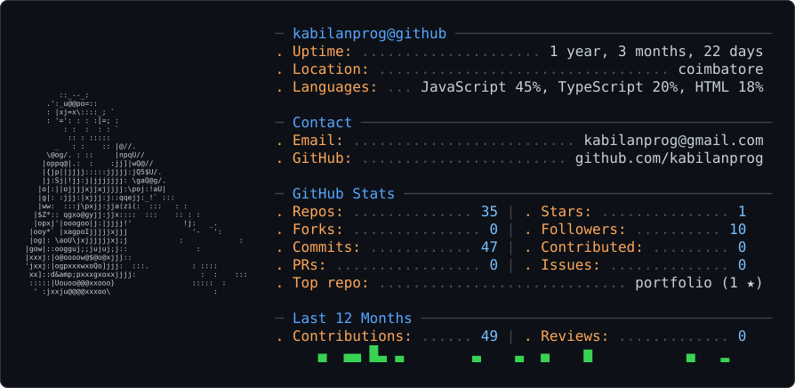

<picture>
  <source media="(prefers-color-scheme: dark)" srcset="dark_mode.svg" />
  <source media="(prefers-color-scheme: light)" srcset="light_mode.svg" />
  
</picture>

## ✨Hi there 👋Kabilan

  ## IT Student 
  

👀 **Interests**  
AI Development · Web Development · Open Source  

🌱 **Currently Learning**  
SQL,Firebase & modern web technologies  

💞 **Looking to Collaborate On**  
- Exciting web development projects  
- Open-source initiatives that create impact  
- Django + AI driven innovations  
- Projects where learning & growth go hand-in-hand  

📫 **How to Reach Me**  
)  
  
  

😄 **Pronouns**  
Const  

⚡ **Fun Facts**  
- I can code faster than I type (almost 😅)  
- Debugging marathons = coffee + 80s rock 🎸  
- VS Code is my go-to tool (its themes are underrated!)  

---

 
  
  ## 🚀 Projects  
- *[Project Name](link):* A bug efficient e_commerce website.  

- ## I code in
- 

- ## IDE and Tools I use
- 

- ## Workspace Spec
- 

<!---
kabilan/kabilan is a ✨ special ✨ repository because its README.md (this file) appears on your GitHub profile.
You can click the Preview link to take a look at your changes.
--->
